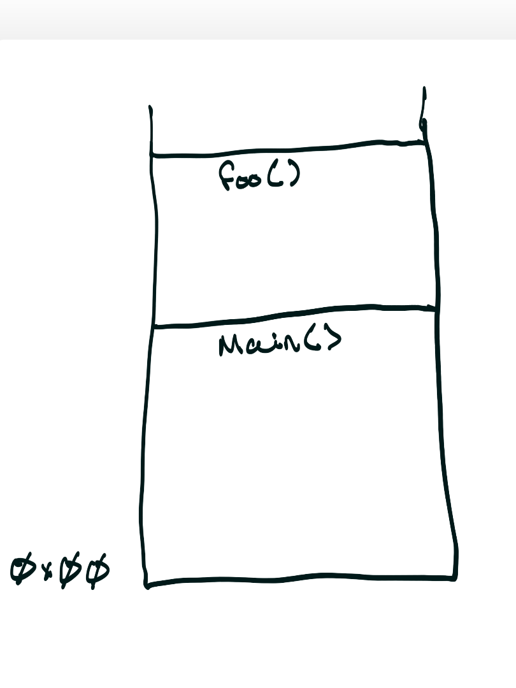
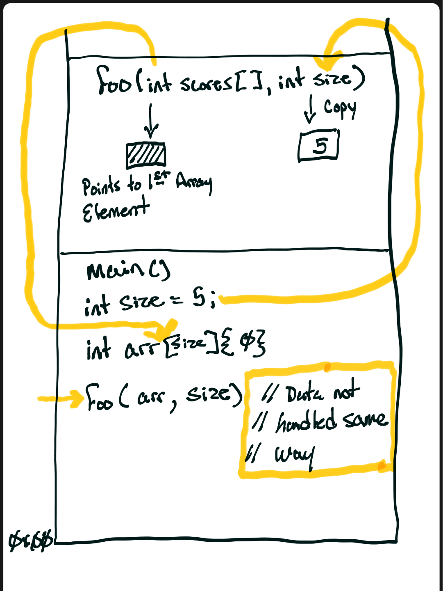

<!-- Topic 1: Arrays with Functions -->
<!-- Slides 4–21 -->

# Arrays with Functions
<!-- Slide 4 -->

## What Crosses the Function Boundary?

{fig-align="center" style="height: 480px; width: auto;"}

::: notes
Slides 4–21
:::

<!-- Slide 5 -->

---

## Two Ways to use Arrays with Functions

+ Pass one element when a function needs one value
+ Pass the array when a function needs the collection

<!-- Slide 6 -->

---

## Pass 1 Array Element {.smaller}

```{.cpp}
void showScore(int score);    // receives one int value

int main() {
    int scores[5] = {91, 78, 84, 95, 62};

    // Example 1: pass one chosen element
    showScore(scores[3]);     // passes 95

    // Example 2: the loop passes each element, one at a time
    for (int i = 0; i < 5; i++) {
        showScore(scores[i]); // passes 91, then 78, 84, 95, 62
    }
    return 0;
}

void showScore(int score) {
    cout << "Score: " << score << "\n";
}
```

+ `scores[i]` is a single `int`, so every call receives a copy of one value
+ The loop changes which element is passed; the function never sees the whole array

<!-- Slide 7 -->

---

## Pass Array

```{.cpp}
void showScores(const int scores[], int size);    // receives the array

int main() {
    int scores[5] = {91, 78, 84, 95, 62};
    showScores(scores, 5);    // passes the array name and its size
    return 0;
}

void showScores(const int scores[], int size) {
    for (int i = 0; i < size; i++) {
        cout << scores[i] << " ";
    }
    cout << "\n";
}
```

+ The array name has no brackets at the call site; the size travels separately

<!-- Slide 8 -->

---

## Passing an Array Parameter Syntax

```{.cpp}
void displayScores(const int scores[], int size);
void addBonus(int scores[], int size, int bonus);
```

+ The brackets mark an array parameter
+ The separate `size` parameter controls traversal
+ `const` marks a read-only array contract

<!-- Slide 9 -->

---

## Not All Data Passed the Same Way

{fig-align="center" style="height: 480px; width: auto;"}

<!-- Slide 10 -->

---

## The Array Is Not Copied

+ A scalar argument gives the function its own value
+ An array argument gives the function access to the caller's elements
+ Writing through the parameter changes the original array

::: notes
[Graphic suggestion: show a caller array with one arrow from the function parameter to the first element. Contrast it with a separate copied scalar value.]
:::

<!-- Slide 11 -->

---

## Array Decay

When a built-in array crosses a function boundary, it **decays** into a pointer to its first element.

| At the call site | Inside the function |
|---|---|
| Complete array | Address of element `0` |
| Element count known from declaration | Element count unavailable |
| `sizeof` reports all element bytes | `sizeof` reports pointer bytes |

<!-- Slide 12 -->

---

## We must Supply Size

```{.cpp}
void displayScores(const int scores[], int size) {
    for (int i = 0; i < size; i++) {
        cout << scores[i] << "\n";
    }
}
```

::: notes
The function can access elements through the address, but the address carries no element count. The caller must provide the logical size.

Once the array is passed to a function, `sizeof` can no longer tell you how many elements it has. The parameter `int scores[]` is really `int* scores`. Only the address of the first element comes across, so inside the function:

```cpp
void displayScores(const int scores[], int size) {
    sizeof(scores);                    // size of a pointer: usually 8 bytes, not 20
    sizeof(scores) / sizeof(scores[0]) // 8 / 4 = 2 on a typical 64-bit system: wrong, and the same for every array
}
```

The code compiles and gives the same wrong number no matter how big the array is, so it's an easy bug to miss. GCC and Clang do warn about it (`-Wsizeof-array-argument`).

`sizeof` still works in the scope where the array is declared, because there it's still a real array. That's why slide 9 does the count in `main` and passes it in:

```cpp
int scores[5] = {91, 78, 84, 95, 62};
int count = sizeof(scores) / sizeof(scores[0]);   // 5: correct here
displayScores(scores, count);
```

There are ways to keep the size, such as passing by reference to an array (`int (&scores)[5]`), `std::array`, or `vector`. Those don't decay. With a plain array parameter, though, the rule is to pass the size separately.
:::

<!-- Slide 13 -->

---

## `sizeof` Inside and Outside a Function

```{.cpp}
int scores[5] = {91, 78, 84, 95, 62};

int count = sizeof(scores) / sizeof(scores[0]);
displayScores(scores, count);
```

+ The count expression works where `scores` is declared
+ After decay, the parameter is no longer a complete array

<!-- Slide 14 -->

---

## Does the Declared Size Matter?

```{.cpp}
void process(int values[]);
void process(int values[5]);
void process(int* values);
```

The `5` does not enforce the argument's size. Pass the logical size separately.

<!-- Slide 15 -->

---

## Read-Only Array Parameters

```{.cpp}
int findMaximum(const int values[], int size);
```

+ `const` prevents assignments to array elements inside the function
+ It communicates that the function observes rather than modifies
+ Use it for display, aggregation, and search functions

<!-- Slide 16 -->

---

## Displaying an Array

```{.cpp}
#include <iostream>
using namespace std;

void displayScores(const int scores[], int size);

int main() {
    int scores[4] = {91, 78, 84, 95};
    displayScores(scores, 4);
    return 0;
}

void displayScores(const int scores[], int size) {
    for (int i = 0; i < size; i++) {
        cout << scores[i] << "\n";
    }
}
```

<!-- Slide 17 -->

---

## Modifying an Array

```{.cpp}
void addBonus(int scores[], int size, int bonus);
```

+ No `const` means the function may write to elements
+ The caller sees every change because the elements were not copied
+ The function name should make the mutation clear

<!-- Slide 18 -->

---

## Updating Every Element

```{.cpp}
#include <iostream>
using namespace std;

void addBonus(int scores[], int size, int bonus);

int main() {
    int scores[4] = {70, 75, 80, 85};
    addBonus(scores, 4, 5);
    cout << scores[0] << " " << scores[3] << "\n";
    return 0;
}

void addBonus(int scores[], int size, int bonus) {
    for (int i = 0; i < size; i++) {
        scores[i] += bonus;
    }
}
```

::: notes
The output is 75 90. Trace one assignment back to the same indexed element in the caller's array.

Any change to an array inside a function modifies the original array. The function receives the address of the caller's first element, not a copy, so `scores[i] += bonus` in `addBonus` writes directly into `main`'s `scores`. That is why `main` prints 75 and 90 rather than 70 and 85. If a function should only read the array, declare the parameter `const` so the compiler blocks accidental changes.
:::

<!-- Slide 19 -->

---

## One Element or the Whole Array?

| Call | Function receives | Typical purpose |
|---|---|---|
| `classify(scores[i])` | One copied `int` | Analyze one score |
| `displayScores(scores, size)` | Access to all elements | Read the collection |
| `addBonus(scores, size, 5)` | Access to all elements | Modify the collection |

<!-- Slide 20 -->

---

## Summary

+ Built-in arrays decay at the function boundary, so pass the size separately
+ Use `const` for read-only access; omit it only when caller-visible mutation is intentional

<!-- Slide 21 -->
