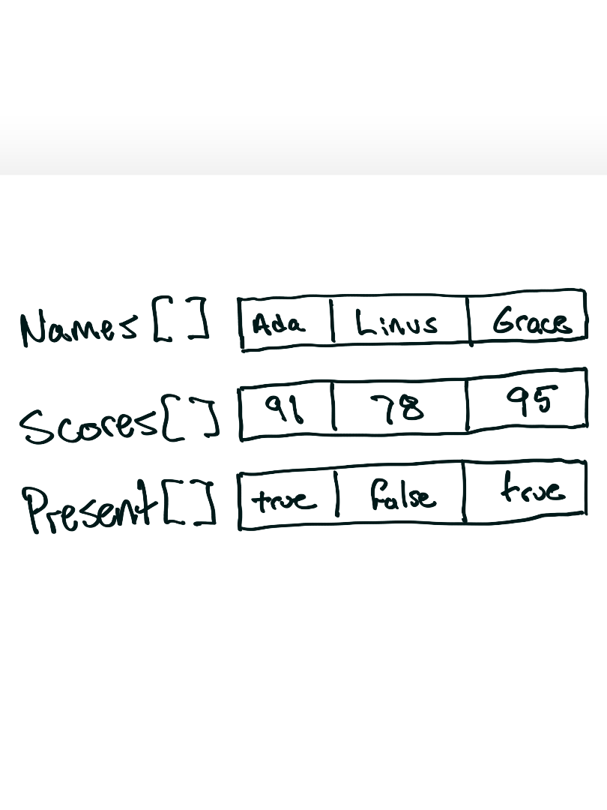
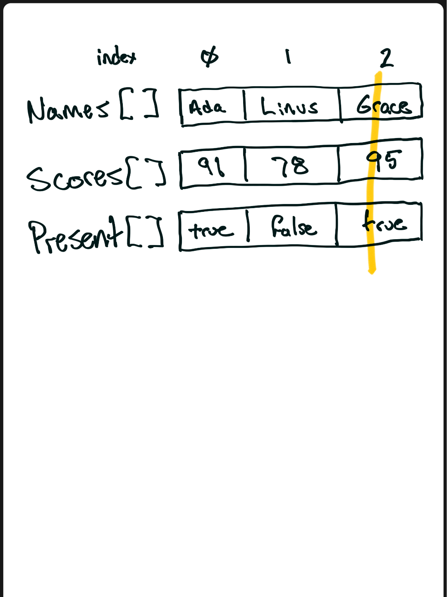

<!-- Topic 3: Parallel Arrays -->
<!-- Slides 45–64 -->

# Parallel Arrays
<!-- Slide 45 -->

## What Happens when we have to Store Arrays of Different Types?

::: notes
Slides 45–64

Talking points (previously on the slide):

+ Separate arrays can store separate attributes
+ A shared index connects the attributes for one entity
:::

<!-- Slide 46 -->

---

## A Parallel-Array Dataset

{fig-align="center" style="height: 480px; width: auto;"}

::: notes
At index `2`, every value describes Grace.
:::

<!-- Slide 47 -->

---

## Key - Realize a Logical Connection

{fig-align="center" style="height: 480px; width: auto;"}

<!-- Slide 48 -->

---

## Declaring Parallel Arrays

```{.cpp}
const int CAPACITY = 5;

string names[CAPACITY];
int scores[CAPACITY];
bool present[CAPACITY];
```

+ Every array uses the same capacity
+ Each position has the same meaning across all arrays

<!-- Slide 49 -->

---

## Capacity and Logical Size

| Name | Meaning |
|---|---|
| `CAPACITY` | Maximum number of records the arrays can hold |
| `size` | Number of records currently stored |

All loops use the same logical `size`, not the full capacity.

<!-- Slide 50 -->

---

## The Shared-Index Contract

For every active index `i`:

+ `names[i]` identifies the entity
+ `scores[i]` stores that entity's score
+ `present[i]` stores that entity's attendance

If one array moves without the others, the dataset becomes incorrect.

<!-- Slide 51 -->

---

## Filling the Arrays Together

```{.cpp}
for (int i = 0; i < size; i++) {
    cout << "Name: ";
    cin >> names[i];
    cout << "Score: ";
    cin >> scores[i];
    cout << "Present (1 or 0): ";
    cin >> present[i];
}
```

<!-- Slide 52 -->

---

## Traversing Related Data

```{.cpp}
for (int i = 0; i < size; i++) {
    cout << names[i] << " "
         << scores[i] << " "
         << present[i] << "\n";
}
```

+ One loop controls every array
+ The index selects one complete logical record

<!-- Slide 53 -->

---

## Passing Parallel Arrays to a Function

```{.cpp}
void displayRecords(const string names[],
                    const int scores[],
                    const bool present[],
                    int size);
```

+ Pass every required field array
+ Pass one shared logical size
+ Use `const` when the function only reads records

<!-- Slide 54 -->

---

## Displaying Records

```{.cpp}
void displayRecords(const string names[],
                    const int scores[],
                    const bool present[],
                    int size) {
    for (int i = 0; i < size; i++) {
        cout << names[i] << " "
             << scores[i] << " "
             << present[i] << "\n";
    }
}
```

<!-- Slide 55 -->

---

## Searching One Array

```{.cpp}
int index = findName(names, size, targetName);
```

+ Search `names` for the requested student
+ Keep the returned index
+ Use that index only when it is not `-1`

<!-- Slide 56 -->

---

## Using the Matching Index

```{.cpp}
if (index != -1) {
    cout << names[index] << "\n";
    cout << scores[index] << "\n";
    cout << present[index] << "\n";
}
```

The search result locates the entire logical record, not only the matched name.

<!-- Slide 57 -->

---

## Finding the Best Record

+ Initialize `bestIndex` to `0`
+ Compare each `scores[i]` with `scores[bestIndex]`
+ Return the index of the highest score

An index preserves access to every related field.

<!-- Slide 58 -->

---

## Best-Record Function

```{.cpp}
int findHighestIndex(const int scores[], int size) {
    int bestIndex = 0;

    for (int i = 1; i < size; i++) {
        if (scores[i] > scores[bestIndex]) {
            bestIndex = i;
        }
    }

    return bestIndex;
}
```

<!-- Slide 59 -->

---

## Moving One Record

```{.cpp}
swap(scores[i], scores[i + 1]);
swap(names[i], names[i + 1]);
swap(present[i], present[i + 1]);
```

Moving only the scores would attach them to the wrong names.

<!-- Slide 60 -->

---

## Sorting Parallel Arrays

```{.cpp}
for (int pass = 0; pass < size - 1; pass++) {
    for (int i = 0; i < size - 1 - pass; i++) {
        if (scores[i] > scores[i + 1]) {
            swap(scores[i], scores[i + 1]);
            swap(names[i], names[i + 1]);
            swap(present[i], present[i + 1]);
        }
    }
}
```

<!-- Slide 61 -->

---

## When Parallel Arrays Work Well

+ The dataset is small and fixed-capacity
+ Every operation uses the same logical size
+ Only a few attributes must stay aligned
+ The shared-index contract remains easy to inspect

<!-- Slide 62 -->

---

## Where the Design Strains

+ Every new field adds another parameter and coordinated operation
+ Sorting or moving records requires updating every array
+ A structure can package all fields for one entity into a single value

<!-- Slide 63 -->

---

## Summary

+ Parallel arrays use one shared index to connect related values
+ Capacity, logical size, traversal, and movement must remain synchronized

<!-- Slide 64 -->
