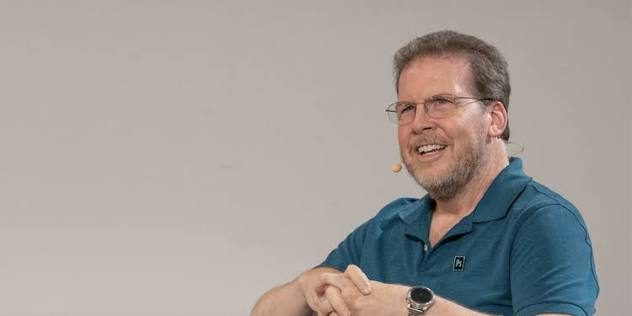

<!-- Topic 0x: Programmer Spotlight: Sean Parent (opening review activity) -->
<!-- Slides 4–7 -->

# Programmer Spotlight: Sean Parent
<!-- Slide 4 -->

## Who Is Sean Parent? {.smaller}

:::: {.columns}

::: {.column width="40%"}
{style="width: 100%; height: auto;"}
:::

::: {.column width="60%"}
- Senior principal scientist and software architect in Adobe's Software Technology Lab
- Joined Adobe in 1993 to work on Photoshop; helped create Photoshop and Lightroom for the web and mobile
- Earlier: Apple's system software team (1988–1993), which built the technology behind the move to PowerPC
- Spent 2009 at Google working on Chrome OS before returning to Adobe
:::

::::

::: notes
Opening review, about 15 minutes. Follow these slides with the handout activity "Expressing Intent Through Abstraction" (raw array loop versus `count_if`), which reviews array traversal from 11.02–13.01. The two programs are in `cpp/program1.cpp` and `cpp/program2.cpp`.

Slides 4–7

Sources: C++Now speaker biography (schedule.cppnow.org/speaker/sean-parent-2/) and Adobe blog, "C++ at Adobe with Sean Parent, senior principal scientist" (April 2021).
:::

<!-- Slide 5 -->

---

## Significant Works

- **"C++ Seasoning"** (GoingNative 2013): three goals for simpler, clearer, correct code
- **"Inheritance Is the Base Class of Evil"** (2013): runtime polymorphism built from value types instead of class hierarchies
- **"Better Code"** talk series and the STLab *Better Code* book: engineering as making informed tradeoffs
- **Hylo** (formerly Val): a language built on value semantics, co-designed with Dave Abrahams; *The Val Object Model* (C++ committee paper P2676, 2022)

::: notes
Students only need the gist: Parent is known less for one library than for a set of talks that changed how many C++ programmers write ordinary code. The recordings of "C++ Seasoning" are a good optional watch.
:::

<!-- Slide 6 -->

---

## His Programming Philosophy

- **No raw loops:** call a named algorithm, or write one, instead of an anonymous loop
- **No raw synchronization primitives:** use higher-level concurrency tools
- **No raw pointers:** prefer value types that manage themselves
- **Local reasoning:** you should understand a piece of code without reading the rest of the program

::: notes
The first three bullets are the three goals from Parent's "C++ Seasoning" talk (GoingNative 2013). The fourth is the reason behind all three.

**No raw loops.** A "raw" loop is a hand-written loop doing a job that already has a name: summing, counting, searching, sorting, finding the largest value. Parent's point is that a reader must trace a raw loop line by line (start index, stopping condition, what changes on each pass) just to discover its purpose, and every one of those details is a chance for an off-by-one error. A named algorithm states the purpose directly: `count_if(begin(scores), end(scores), isPassing)` reads as "count the passing scores." When no standard algorithm fits, the advice is not "never write a loop" but "put the loop in a well-named function of its own," which is exactly what students did in 12.01 with `findMaximum` and `linearSearch`. Today's handout activity (Program 1 versus Program 2) is this bullet in practice.

**No raw synchronization primitives.** This one is about programs that do several things at the same time (threads), which CISP 360 does not cover. Low-level tools such as mutexes (locks) and atomic variables let threads share data safely, but only if every piece of code uses them correctly, and the resulting bugs are intermittent and very hard to reproduce. Parent recommends higher-level tools, such as tasks and futures, that hand work to another thread and collect the result without the programmer managing locks directly. For students, the takeaway is the pattern: the lowest-level tool is rarely the one you should reach for first.

**No raw pointers.** Parent means raw pointers used to own or manage memory: `new` and `delete` written by hand, or pointers passed around so that many parts of a program can reach the same object. He prefers value types: objects that manage their own storage and behave like an `int`, so copying one gives you an independent copy. `vector`, `string`, and `std::array` are value types that students already use. In "C++ Seasoning" he extends the caution even to shared ownership with smart pointers, because an object reachable from many places is hard to reason about. This is not a reason to skip today's lecture: references, containers, and smart pointers are all built on pointers, and you cannot judge a tool you do not understand. The rule is about what you write in application code, not about what you need to know.

**Local reasoning.** This is the principle behind the other three. You should be able to understand what a piece of code does by reading that piece and the interfaces it uses, without searching the rest of the program for whatever else might change the same data. Raw loops hide intent, raw synchronization hides which thread touches what, and raw pointers hide who else can modify an object. Each rule removes a reason you would otherwise have to read code somewhere else. This idea runs through Parent's later work too, including the Hylo language, which is built on value semantics so that each piece of code can be reasoned about on its own.
:::

<!-- Slide 7 -->
