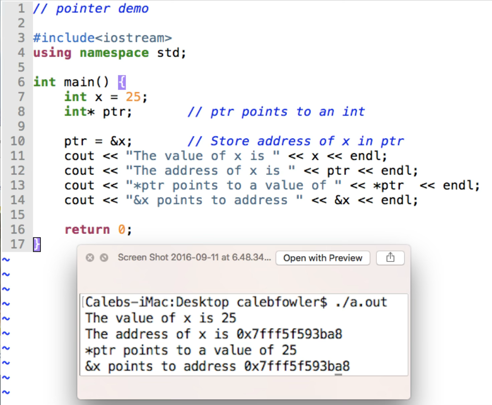
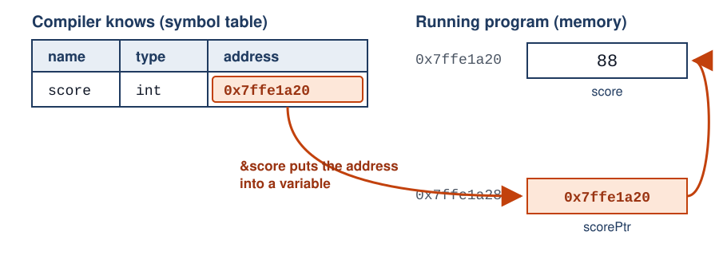
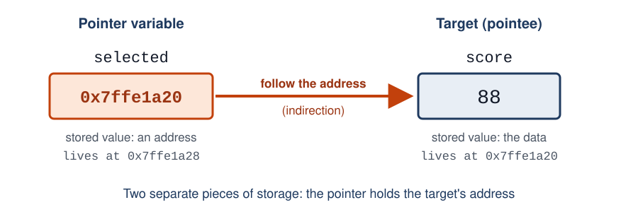

<!-- Topic 1: Introduction to Pointers -->
<!-- Slides 8–18 -->

# Introduction to Pointers
<!-- Slide 8 -->

## When Does a Name Stop Being Enough? {.smaller}

- A variable name identifies one object
- What if the program must choose the object while it is running?

::: notes
Slides 8–18
Ask students to imagine one operation that might update either of two counters. The operation is fixed, but its target is not.
:::

<!-- Slide 9 -->

---

## Pointer Demo

{fig-align="center" style="height: 480px; width: auto;"}

::: notes
The program stores the address of `x` in `ptr`, then prints four things: the value of `x` (25), the address stored in `ptr`, the value reached by dereferencing `*ptr` (25), and `&x`. The two addresses match because `ptr` holds the address of `x`; the exact address differs from run to run and machine to machine. Don't explain the syntax yet: topic 2 takes each piece in turn (the address operator, declaring a pointer, and dereferencing). Here the goal is to see a pointer hold an address and lead back to a value.
:::

<!-- Slide 10 -->

---

## From Symbol Table to Runtime Data

{fig-align="center" style="height: 330px; width: auto;"}

- A name lets the compiler locate an object
- A pointer makes an object's address available to the running program

<!-- Slide 11 -->

---

## What Is a Pointer?

- A **pointer** is a typed variable whose value is a memory address
- The object at that address is the pointer's **target** or **pointee**
- Using the address to reach the target is **indirection**

<!-- Slide 12 -->

---

## The Pointer Model

{fig-align="center" style="height: 300px; width: auto;"}

- The pointer has its own storage, separate from its target

<!-- Slide 13 -->

---

## Why Store an Address?

- Select an existing object while the program runs
- Read or modify that object indirectly
- Describe positions and ranges in contiguous data
- Give a function access to a large object without copying it

<!-- Slide 14 -->

---

## One Operation, Different Targets

| Before selection | Runtime choice | After operation |
|---|---|---|
| `regular = 40` | target `regular` | `regular = 35` |
| `sale = 28` | target `sale` | `sale = 23` |

- The operation: subtract 5 from whichever price is selected
- The operation stays the same while the selected target changes

::: notes
Keep this example conceptual. The same example returns in C++ on the "One Operation, Runtime Choice" slide (slide 34) in topic 2.
:::

<!-- Slide 15 -->

---

## Pointers Are Not the Default

| Need | Prefer |
|---|---|
| Store a value | ordinary variable |
| Require another name for an existing object | reference |
| Represent address semantics or no target | pointer |

- Use the highest-level tool that clearly expresses the design
- Pointers still matter: the next lectures use them for arrays and dynamic memory

<!-- Slide 16 -->

---

## Capability Comes With Responsibility

A pointer may be used only when it identifies:

- An object of the expected type
- An object whose lifetime has not ended
- A location within the operation's permitted boundary

<!-- Slide 17 -->

---

## Introduction to Pointers: Summary

- Pointers store typed addresses and provide indirect access to objects
- Address semantics enable runtime flexibility but add validity and lifetime responsibilities
- Modern C++ uses raw pointers selectively and prefers higher-level ownership and container tools

<!-- Slide 18 -->
