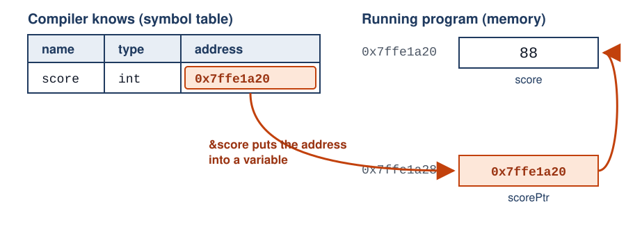

<!-- Topic 2: Initializing and Using Pointers -->
<!-- Slides 19–38 -->

# Initializing and Using Pointers
<!-- Slide 19 -->

## How Does a Pointer Reach a Variable? {.smaller}

- The target already has an address
- How do we obtain that address and store it safely?

::: notes
Slides 19–38
:::

<!-- Slide 20 -->

---

## The Address Operator

```{.cpp}
int score = 88;

cout << &score << "\n";
```

- Unary `&` produces the address of an object
- Addresses print in hexadecimal and change from run to run, so don't try to interpret them

<!-- Slide 21 -->

---

## Declaring a Pointer Variable

```{.cpp}
int* scorePtr;
```

| Part | Meaning |
|---|---|
| `int` | target type |
| `*` | pointer declarator |
| `scorePtr` | pointer variable name |

<!-- Slide 22 -->

---

## Match the Pointer to the Target

```{.cpp}
int score = 88;
double average = 91.5;

int* scorePtr = &score;
// int* wrongPtr = &average; // incompatible target type
```

<!-- Slide 23 -->

---

## Declare One Pointer at a Time

```{.cpp}
int* first, second;
```

- `first` is an `int` pointer
- `second` is an ordinary `int`

```{.cpp}
int* first;
int* second;
```

<!-- Slide 24 -->

---

## Initialize With an Address

```{.cpp}
int score = 88;
int* scorePtr = &score;
```

{fig-align="center" style="height: 300px; width: auto;"}

::: notes
This is the same diagram as slide 11. Now students can read the line of code that produces it: `&score` supplies the address, and `scorePtr` stores it.
:::

<!-- Slide 25 -->

---

## Initialize With `nullptr`

```{.cpp}
int* selected = nullptr;
```

- `nullptr` deliberately represents no target
- Use it when a valid target is not yet available
- In modern C++, prefer `nullptr` over `NULL` or `0`

<!-- Slide 26 -->

---

## Valid, Null, or Indeterminate?

| Pointer state | Meaning | Dereference? |
|---|---|---|
| valid address | identifies a live target | yes |
| `nullptr` | deliberately identifies no target | no |
| uninitialized | indeterminate value | no |
| dangling | holds an address, but the target's lifetime has ended | no |

- Reading or dereferencing an uninitialized or dangling pointer has undefined behavior

<!-- Slide 27 -->

---

## What Does Dereferencing Mean?

```{.cpp}
int score = 88;
int* scorePtr = &score;

cout << *scorePtr << "\n";
```

`scorePtr` → address of `score` → `88`

- Unary `*` follows the stored address to the target
- Reading `*scorePtr` gives the target's value, `88`

::: notes
Trace three distinct facts: the pointer's stored address, the target's value, and whether dereferencing is valid.
:::

<!-- Slide 28 -->

---

## One Symbol, Several Meanings

| Code | Symbol and context | Meaning |
|---|---|---|
| `int* ptr;` | `*` in a declaration | `ptr` is a pointer to `int` |
| `*ptr = 95;` | `*` before one operand | dereference: follow the address |
| `score * 2` | `*` between two operands | multiplication |
| `ptr = &score;` | `&` before one operand | address of `score` |
| `int& alias = score;` | `&` in a declaration | `alias` is a reference to `score` (Week 5) |

- Read the context: is it a declaration, and how many operands does the symbol have?

::: notes
This is the most common source of confusion in the pointer unit. Point at each row and ask students to say the meaning out loud before revealing it.
:::

<!-- Slide 29 -->

---

## Four Related Expressions

```{.cpp}
int value = 88;
int* ptr = &value;
```

| Expression | Result |
|---|---|
| `value` | target value |
| `&value` | target address |
| `ptr` | stored address |
| `*ptr` | value reached through `ptr` |

<!-- Slide 30 -->

---

## Writing Through a Pointer

```{.cpp}
int score = 88;
int* scorePtr = &score;

*scorePtr = 95;
cout << score << "\n";
```

- `score` changes from `88` to `95`
- `scorePtr` continues to store the same address

<!-- Slide 31 -->

---

## Predict the State

```{.cpp}
int points = 10;
int* ptr = &points;

*ptr = 14;
points += 3;
```

- What is `points`?
- What is `*ptr`?
- Has the address stored in `ptr` changed?

::: notes
Answer: points and *ptr are both 17. ptr still stores the address of points.
:::

<!-- Slide 32 -->

---

## Changing the Target

```{.cpp}
int first = 10;
int second = 20;
int* ptr = &first;

ptr = &second;
```

- `ptr = &second;` changes the target
- `*ptr = 25;` would change the current target's value

<!-- Slide 33 -->

---

## One Operation, Runtime Choice

```{.cpp}
int regularPrice = 40;
int salePrice = 28;
bool saleIsActive = true;

int* selected = &regularPrice;
if (saleIsActive) {
    selected = &salePrice;
}

*selected -= 5;
```

- Which price changes, and what is its new value?
- This is the "subtract 5" operation from slide 15, now in C++

::: notes
Answer: `salePrice` becomes 23 because `selected` was reseated to it; `regularPrice` stays 40. The operation line never changed; only the target did.
:::

<!-- Slide 34 -->

---

## Check Before Dereferencing

```{.cpp}
int* selected = nullptr;

if (selected != nullptr) {
    cout << *selected << "\n";
}
```

- A null check prevents dereferencing the no-target state
- Non-null is necessary, but the target must also still be alive

<!-- Slide 35 -->

---

## When a Target Disappears

```{.cpp}
int* ptr = nullptr;

{
    int temporary = 42;
    ptr = &temporary;
} // temporary's lifetime ends
```

- `ptr` is now dangling: it contains an address but has no live target
- A null pointer and a dangling pointer are different invalid states

<!-- Slide 36 -->

---

## A Complete Pointer Lifecycle

```{.cpp}
int first = 10;
int second = 20;
int* selected = &first;

*selected += 5;
selected = &second;
*selected += 5;

selected = nullptr;
```

::: notes
Trace: selected starts at first; first becomes 15; selected is reseated to second; second becomes 25; selected is reset to the deliberate no-target state.
:::

<!-- Slide 37 -->

---

## Initializing and Using Pointers: Summary

- Initialize every pointer with a valid address or `nullptr`
- Dereference only when the pointer identifies a compatible, live target
- Distinguish changing a pointer's target from changing the target's value

<!-- Slide 38 -->
